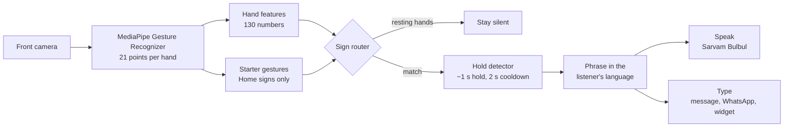

# Ishara

**Sign it. It speaks.** Ishara (ইশারা, इशारा: "a gesture" in Bengali and Hindi) turns one person's own hand signs into speech or text, in the listener's language. Hand tracking and sign matching run entirely on the device.

**Live app:** https://neelabhra08.github.io/build-for-one-top-g-s/ (phone or laptop, no sign-in: tap **Start Ishara** and allow the camera)

## Contents

1. [Problem](#problem)
2. [Features](#features)
3. [Architecture](#architecture)
4. [How recognition works](#how-recognition-works)
5. [ASL starter pack](#asl-starter-pack)
6. [API](#api)
7. [Data formats and storage](#data-formats-and-storage)
8. [Getting started](#getting-started)
9. [Configuration](#configuration)
10. [Deployment](#deployment)
11. [Security and privacy](#security-and-privacy)
12. [Testing](#testing)
13. [Project structure](#project-structure)
14. [Limitations and roadmap](#limitations-and-roadmap)
15. [Credits](#credits)

## Problem

Ishara is built for one person who cannot speak. Every day they need to say small, urgent things: *I need water*, *I need the washroom*, *I am in pain*, *please call my son*. The people around them speak different languages: family in Bengali, the attendant in Hindi, the doctor in English.

Existing options fail this person:

| Option | Limitation |
|---|---|
| Picture boards (AAC apps) | Unlock, open, search for the picture: slow when in pain, hard with an unsteady hand |
| Sign language recognition models | Fixed vocabulary of one formal sign language, English output, accuracy drops sharply on a new signer, and no support for home signs |
| Human interpreters | Not available around the clock |

There are more than 300 sign languages, regional variants of Indian Sign Language, and countless home signs that only one family understands. Ishara therefore learns the signs of the person who uses it, instead of expecting the person to learn a standard.

## Features

| Feature | Details |
|---|---|
| Home signs from the first minute | 7 starter gestures: thumb up (yes), thumb down (no), closed fist (pain), point up (water), two fingers (washroom), open palm (wait), thumb, index and little finger (thank you) |
| Teach a sign in 3 seconds | Type a phrase, show the sign, use it immediately; one or two hands; no server-side training |
| ASL starter pack | 10 American Sign Language signs built from recordings of 21 Deaf signers, 87% correct on unseen signers |
| Listener languages | Three listeners (Family, Attendant, Doctor), each with one of 12 languages and one of 37 Sarvam Bulbul voices |
| Speak or Type | Speak plays the phrase aloud; Type builds a message from several signs and sends it on WhatsApp, copies it, or reads it out |
| Desktop widget | Windows bubble that types the signed phrase into the focused application (Ctrl + Shift + Space) |
| Silent when unsure | Hold-to-confirm, per-sign thresholds, a "resting hands" class and a "No, wrong" cancel |
| Offline voice fallback | Bundled Sarvam voices for all built-in and ASL phrases, then the device voice |

Supported languages: Bengali, Hindi, English, Marathi, Telugu, Tamil, Gujarati, Kannada, Odia, Malayalam, Punjabi (spoken), and Urdu (text only, as Bulbul has no Urdu voice).

## Architecture



Everything left of the phrase runs in the browser or the Electron widget. Only phrase text leaves the device, for voice and translation.

| Module | Responsibility |
|---|---|
| `src/lib/vision.js` | Loads the MediaPipe Gesture Recognizer (WebAssembly, GPU delegate with CPU fallback) from the app's own origin |
| `src/lib/handFeatures.js` | Converts hand landmarks into a normalized 130-number feature vector |
| `src/lib/personalClassifier.js` | Nearest-match classifier, per-sign thresholds, resting class, lookalike detection |
| `src/lib/holdDetector.js` | Turns a stream of per-frame labels into single, confirmed sign events |
| `src/lib/router.js` | Shared routing for the web app and the widget |
| `src/lib/signStore.js` | Sign sets per sign language, persistence, pack import, export and validation |
| `src/lib/translations.js` | Translation cache, bundled translations, Sarvam translation |
| `src/lib/speech.js`, `sarvamDirect.js` | Voice: bundled MP3s, local API, direct Sarvam call (hosted build), device voice fallback |
| `api/tts.js`, `api/translate.js` | Server routes that keep the Sarvam key off the device (local and desktop builds) |
| `desktop/main.cjs`, `preload.cjs` | Electron widget: focus-less always-on-top window, global hotkey, paste into the focused app |

**Stack:** React 19.3.1, Vite 8.3.8, MediaPipe Tasks Vision 1.2.2 (gesture recognizer, float16, 8.4 MB), Electron 45.2.3, Vitest 5.1.1, Node.js 24. Voice and translation by Sarvam AI (`bulbul:v3`, `sarvam-translate:v1`).

## How recognition works

### Hand features

For each camera frame, MediaPipe returns 21 landmarks per hand. `extractFeatures` builds a 130-number vector:

| Indices | Content |
|---|---|
| 0 | Hand A present (1 or 0) |
| 1 to 63 | Hand A: 21 points × (x, y, z) |
| 64 | Hand B present |
| 65 to 127 | Hand B: 21 points × (x, y, z) |
| 128, 129 | Offset from hand A's wrist to hand B's wrist |

Normalization makes the vector independent of where the hand is and how close it is:

- x is multiplied by the camera aspect ratio, so portrait phones and landscape laptops agree.
- Every point is taken relative to the wrist and divided by the palm length (wrist to middle knuckle).
- Depth is weighted by 0.5 because it is the noisiest axis.
- Two hands are ordered left to right; one-hand and two-hand signs never match each other.

### Classifier

- **Distance:** root mean square difference over the present hands, plus the two-hand offset weighted by 4.
- **Score per sign:** the mean distance to its 3 nearest examples.
- **Threshold per sign:** 4 × the median nearest-neighbour distance among its own examples, clamped to 0.12 to 0.45, multiplied by the strictness setting (strict 1, normal 1.5, loose 2.2).
- **Resting class:** if relaxed, everyday hand movement is the closest match, nothing is said.
- **Lookalike check:** when a new sign is taught, its distance to existing signs is compared with their spreads, and the family is warned.

### Hold detector

A sign fires only after the same label is seen for 900 ms. Tracking dropouts of up to 250 ms are tolerated, a 2-second cooldown follows, and the hand must change or drop before the same sign fires again.

### Teaching

A 3-second countdown, then 3 seconds of capture at one example every 120 ms (about 24 per take). A sign can be saved from 8 examples; up to 40 are kept (150 for imported packs).

## ASL starter pack

The pack (`public/packs/asl.json`) is built with `scripts/asl_pack.py` from the Google Isolated Sign Language Recognition data: MediaPipe landmarks from about 94,000 recordings of 250 ASL signs by 21 Deaf signers.

1. Download the index and 20 to 25 recordings per sign, each from a different signer where possible.
2. Take frames from the middle 60% of each recording and add mirrored copies for left-handed signing.
3. Convert them with the same feature maths as the app. A parity test confirms identical output (130 of 130 values, difference 0).
4. Evaluate: first 70% of each sign's recordings as examples, the rest (mostly unseen signers) as test frames.
5. Select signs greedily (`scripts/prune_pack.mjs`): keep a sign only if it reaches 70% without pulling an essential sign below 70%. All 30 candidate signs together scored 51%, because many ASL signs share a hand shape and differ by movement.

| Sign | Phrase | Correct (single frame) |
|---|---|---|
| WATER | I need water | 100% |
| TIME | What time is it? | 100% |
| CALL ON PHONE | Please call my family | 95% |
| FOOD | I want food | 94% |
| BYE | Goodbye | 89% |
| POTTY | I need the washroom | 82% |
| HUNGRY | I am hungry | 80% |
| STAY | Please stay with me | 80% |
| THANK YOU | Thank you | 77% |
| BATH | I want to bathe | 73% |
| **Total** | | **87% correct, 10% wrong, 3% silent** |

The hold detector filters out a further share of single-frame errors in use.

## API

Local and desktop builds serve two routes (Vite dev middleware; the same handlers run as serverless functions).

### `POST /api/tts`

| Field | Type | Rules |
|---|---|---|
| `text` | string | 1 to 300 characters |
| `language` | string | `bn-IN`, `hi-IN`, `en-IN`, `mr-IN`, `te-IN`, `ta-IN`, `gu-IN`, `kn-IN`, `od-IN`, `ml-IN`, `pa-IN` |
| `speaker` | string | One of the 37 Bulbul v3 voices (default `rupali`) |

Returns `audio/mpeg`. Errors: `400` invalid input, `405` wrong method, `502` Sarvam failed, `503` no key configured.

### `POST /api/translate`

| Field | Type | Rules |
|---|---|---|
| `text` | string | 1 to 300 characters |
| `source`, `target` | string | The 11 languages above plus `ur-IN` |

Returns `{ "text": "..." }`.

## Data formats and storage

Signs never leave the device. Browser storage keys:

| Key | Content |
|---|---|
| `ishara.mysigns.v1` | Sign sets (`home`, `asl`), selected sign language, resting examples, strictness |
| `ishara.settings.v1` | Language and voice for each listener |
| `ishara.translations.v1` | Cached translations |

Sign pack file (export, import and bundled packs):

```json
{
  "format": "ishara-pack",
  "version": 1,
  "signLanguage": "asl",
  "recordedBy": "family",
  "signs": [
    {
      "id": "asl-water",
      "en": "I need water",
      "bn": "আমার জল চাই",
      "hi": "मुझे पानी चाहिए",
      "icon": "drop",
      "examples": [[1, 0.0, 0.0, "... 130 numbers per example"]],
      "threshold": 0.25
    }
  ]
}
```

Imported packs are validated: every example must be exactly 130 finite numbers, phrases are capped at 120 characters, and examples are capped per sign.

## Getting started

Requirements: Node.js 24, npm 11, a webcam, and a Sarvam API key from dashboard.sarvam.ai.

```bash
npm install
```

Create `.env.local` (git-ignored):

```bash
SARVAM_API_KEY=your-key-here
```

Run the web app at http://localhost:5173:

```bash
npm run dev
```

Run the desktop widget (Windows, with the web app running):

```bash
npm run desktop
```

Run the tests:

```bash
npm test
```

Regenerate the bundled voices and translations:

```bash
node --env-file=.env.local scripts/static_assets.mjs
```

## Configuration

| Variable | Used by | Purpose |
|---|---|---|
| `SARVAM_API_KEY` | Local server, scripts | Sarvam key, read from `.env.local` |
| `VITE_BASE` | Build | Base path, `/build-for-one-top-g-s/` on GitHub Pages |
| `VITE_SARVAM_BROWSER_KEY` | Hosted build | Demo key for direct Sarvam calls where no server exists |
| `ISHARA_URL` | Desktop widget | Web app address (default `http://localhost:5173`) |

## Deployment

`.github/workflows/pages.yml` runs on every push to `main`: install, run the tests, build with the Pages base path, and publish to GitHub Pages. Every action is pinned to a commit hash. A failing test stops the deploy.

The hosted build has no server, so it ships pre-generated Sarvam voices and translations for every built-in and ASL phrase and calls Sarvam directly for anything else.

## Security and privacy

- Camera frames are processed on the device and never uploaded; signs are stored as numbers, never images.
- Only phrase text is sent to Sarvam.
- Local and desktop builds keep the Sarvam key on the server side. The hosted demo uses a restricted demo key that is rotated after the demo period.
- The widget accepts text only from the app's own origin, caps it at 300 characters, restores the clipboard after pasting, and denies navigation and new windows.
- The camera permission is granted only to the app's own origin in the widget.

## Testing

| Suite | Covers |
|---|---|
| `holdDetector.test.js` | Fires once after a hold, ignores flashes and low confidence, survives dropouts, respects the cooldown |
| `personalSigns.test.js` | Position, size and camera-aspect invariance, shape separation, one-hand versus two-hand, recognition, resting class, unknown shapes, lookalikes |
| `compose.test.js` | Sentence joining with language-specific full stops (Latin, Bengali and Hindi, Urdu) |

18 tests, run locally with `npm test` and on every deploy.

## Project structure

```
api/            server routes for voice and translation
desktop/        Electron widget (main process and preload)
docs/PRD.md     product requirements written before the build
public/         hand model, sign packs, bundled voices and translations
scripts/        ASL pack builder, pack pruner, voice and translation generator
src/            React app, widget UI, and the recognition library in src/lib
```

## Limitations and roadmap

Limitations:

- Signs are matched on hand shape per frame. Signs that differ only by movement or location can be confused.
- Packs recorded by other signers are less accurate than signs taught by the user.
- Typing into other applications is Windows-only.
- Ishara is not a medical device and does not replace interpreters or emergency services. In a medical emergency, call 112.

Roadmap:

1. Movement-aware matching over short landmark sequences.
2. Teaching a sign from a short video.
3. An Android keyboard that types signs into any app.
4. Optional end-to-end encrypted sync of signs between family devices.
5. A small server for the hosted build so no key reaches the browser.

## Credits

- Hand tracking: MediaPipe Gesture Recognizer (Google, Apache 2.0).
- Voices and translation: Sarvam AI.
- ASL starter pack: derived hand-point features only, from the Google Isolated Sign Language Recognition competition data on Kaggle (kaggle.com/competitions/asl-signs), built on PopSign by Georgia Tech, NTID at RIT and Deaf Professional Arts Network. The data is subject to the competition's rules; contact the maintainers to have the pack removed.
- Built by team Top G's.
